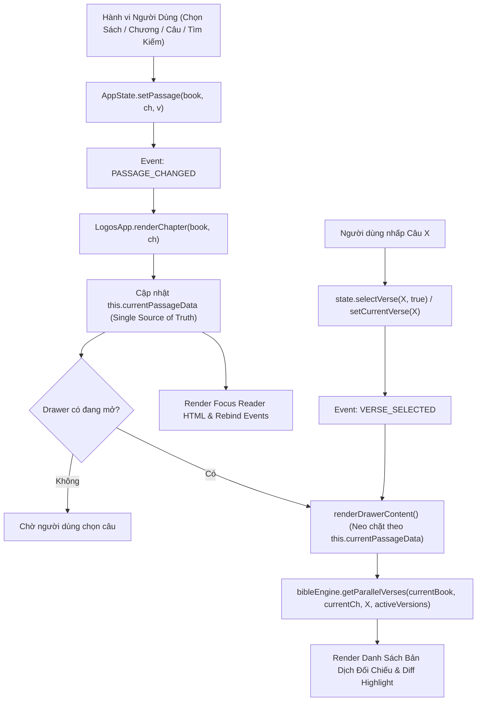

# 🏛️ LOGOS MULTIVERSE — KIẾN TRÚC & NGUYÊN TẮC BẤT BIẾN (ARCHITECTURE INVARIANTS)

> **Mục tiêu**: Hướng dẫn kỹ thuật và quy chuẩn phát triển cho toàn bộ các lập trình viên và AI Agent khi bổ sung, tinh chỉnh các tính năng mở rộng (Khách, Thành viên, Quản trị viên, Blog, Cộng đồng, AI Chatbot, Media) mà **tuyệt đối không gây ảnh hưởng hay làm vỡ tính năng Đọc & Đối Chiếu Kinh Thánh Đa Bản Dịch**.

---

## 1. HẠT NHÂN BẤT BIẾN (CORE INVARIANTS)

Trọng tâm giá trị của Logos MultiVerse là **Đối Chiếu Song Song Đa Bản Dịch Chính Xác và Liền Mạch**.



---

## 2. NGUYÊN TẮC 1: ĐƠN NGUỒN CHÂN LÝ (SINGLE SOURCE OF TRUTH)

- Thuộc tính `this.currentPassageData` trên `LogosApp` (trong `js/app.js`) là nguồn chân lý duy nhất phản ánh phân đoạn thực tế đang hiển thị trên Focus Reader.
- Khi render Bảng Khảo Cứu (`renderDrawerContent`):
  ```javascript
  const currentBookId = this.currentPassageData.book_id || state.currentBook;
  const currentChapterNum = this.currentPassageData.chapter_num || state.currentChapter;
  if (state.currentBook !== currentBookId) state.currentBook = currentBookId;
  if (state.currentChapter !== currentChapterNum) state.currentChapter = currentChapterNum;
  ```
- **Nghiêm cấm**: Tuyệt đối không đọc trực tiếp biến độc lập ngoài luồng mà không đối chiếu với `this.currentPassageData`.

---

## 3. NGUYÊN TẮC 2: TỰ ĐỘNG ĐỒNG BỘ KHÉP KÍN (CLOSED-LOOP SYNCHRONIZATION)

1. **Khi Chuyển Phân Đoạn**:
   - Mọi sự kiện đổi sách/đoạn (`PASSAGE_CHANGED`) phải bảo đảm:
     ```javascript
     this.renderChapter(data.book, data.chapter).then(() => {
       if (state.isDrawerOpen) this.renderDrawerContent();
     });
     ```
   - Trong chính cuối hàm `renderChapter`, sau khi đã gắn sự kiện và highlight câu, lập tức gọi `if (state.isDrawerOpen) this.renderDrawerContent();`.
2. **Khả Năng Chịu Lỗi Của API Điều Hướng**:
   - `AppState` bắt buộc duy trì cả `selectVerse(verseNum, openDrawer)` và `setCurrentVerse(verseNum)`.
   - `navigateToPassage(book, ch, v)` phải luôn kích hoạt `state.selectVerse(v, true)` và `this.renderDrawerContent()`.

---

## 4. NGUYÊN TẮC 3: PHÒNG NGỰ DỮ LIỆU ĐỐI CHIẾU (ZERO BLANK SCREEN MANDATE)

1. **Không Bao Giờ Trả Về Mảng Rỗng Nếu Có Dữ Liệu Phân Đoạn**:
   - Trong `bibleEngine.getParallelVerses(bookId, chapterNum, verseNum, selectedVersions)`:
     - Fallback tìm kiếm key không phân biệt hoa thường trong `this.passagesCache`.
     - Nếu `verseNum` không tồn tại trong phân đoạn (ví dụ người dùng chọn câu 10 trên phân đoạn ngắn), tự động fallback về câu 1 hoặc câu đầu tiên của chương thay vì trả về `[]`.
2. **Fallback Sinh Câu Offline Đầy Đủ**:
   - `generateSmartPassage` phải sinh tối thiểu 25 câu để bảo đảm câu 1 đến 25 luôn có nội dung đối chiếu hợp lệ ngay cả trong tình huống ngoại tuyến hoặc chưa kịp tải tệp JSON.

---

## 5. NGUYÊN TẮC 4: CÔ LẬP VÀ PHÂN TẦNG TÍNH NĂNG (FEATURE SANDBOXING & DECOUPLING)

| Phân Tầng | Thành Phần | Quy Tắc Quyền Hạn |
| :--- | :--- | :--- |
| **Hạt Nhân (Core L1)** | Focus Reader, Parallel Engine, Drawer Inspector | Quản lý độc quyền `currentPassageData`, `passagesCache`, `activeVersions`, `primaryVersion`. |
| **Giải Kinh (Hermeneutics L2)** | Metaphors, TSK Cross-References, Genre Guides | Chỉ ĐỌC dữ liệu từ L1, không ghi đè phân đoạn đọc nếu không có hành vi bấm "Đọc Cả Đoạn". |
| **Bổ Trợ Người Dùng (Features L3)** | Blog, Nhánh Thảo Luận, Video Media, Berea AI | Hoạt động hoàn toàn độc lập trong container riêng (`#blog-view`, `#community-view`, `#media-view`, `#floating-ai-widget`). **Tuyệt đối không can thiệp vào State của L1.** |
| **Quản Trị (Admin L4)** | Banner Editor, Article Studio, Analytics | Cần mật khẩu `logos777`. Chỉ lưu trữ cấu hình qua `storage` (LocalStorage), không thay đổi cấu trúc dữ liệu Kinh Thánh. |

---

## 6. NGUYÊN TẮC 5: TƯỜNG LỬA KIỂM THỬ TỰ ĐỘNG (CI/CD REGRESSION GUARD)

Trước khi nghiệm thu bất kỳ thay đổi nào về giao diện hay tính năng khách:
```powershell
python -m pytest tests/ -v
```
Toàn bộ 84 test suites (bao gồm `test_parallel_sync.py`, `test_admin_capabilities.py`, `test_mobile_ux_architecture.py`, `test_end_to_end.py`...) phải đạt **100% Pass**.

---

## 7. NGUYÊN TẮC 6: BẢO TOÀN HIỂN THỊ MÁY TÍNH & KHẾ ƯỚC PHÂN TÁCH GIAO DIỆN (DESKTOP LAYOUT LOCK)

1. **Khế Ước Desktop Viewport (`@media (min-width: 992px)`)**:
   - Giao diện máy tính hiện tại (Header đầy đủ, Thanh chọn thể loại văn chương, Kệ sách động, Vùng đọc Focus Reader và Bảng Khảo cứu đối chiếu Side-by-Side 520px margin-right offset) là **bất biến và cố định 100%**.
   - Các phần tử di động như `#mobile-bottom-nav` và `.bottom-sheet-drag-handle` bị ẩn triệt để bằng `display: none !important`.
   - Mọi chỉnh sửa giao diện responsive cho điện thoại di động **chỉ được phép thực hiện** trong các khối `@media (max-width: 991px)` và `@media (max-width: 640px)`.

2. **Quy Chuẩn Đối Chiếu Di Động (Mobile Ergonomic UX)**:
   - **Dynamic Half-Height Bottom Sheet (50/50 Drawer)**: `#drawer-inspector` trượt từ đáy lên (`bottom: 0`, cao mặc định 56vh), bo góc 20px, có thanh kéo `#bottom-sheet-drag-handle`.
   - **Tự động Căn Chỉnh Câu Đang Chọn (Auto-Scroll Offset)**: Khi chạm vào bất kỳ câu Kinh Thánh nào trên điện thoại, hệ thống tự động cuộn câu đó lên 25%-35% trên cùng màn hình, đảm bảo câu gốc ở nửa trên và các bản dịch đối chiếu ở nửa dưới luôn cùng hiển thị song song.
   - **Thanh Điều Hướng Vùng Ngón Tay Cái (Thumb-Zone Mobile Bottom Navigation)**: Thanh `#mobile-bottom-nav` cố định dưới đáy với 5 nút chức năng: `[📖 Đọc]`, `[🔀 Đối Chiếu]`, `[🔍 Tìm Kiếm]`, `[🤖 Berea AI]`, và `[☰ Menu Khám Phá]`.
   - **Menu Khám Phá Di Động (`#mobile-menu-modal`)**: Cho phép chuyển nhanh không gian (Kinh Thánh, Blog, Cộng Đồng, Media, Bản Dịch, Đổi Theme, Đăng Nhập Quản Trị).

